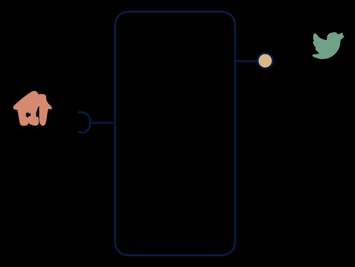

# 6.5 — Poller → stream bridge

**Interface:** IN `{R}` → OUT `{S}`&emsp;&emsp;**Verdict:** niche

The canonical "bridge an API world into a Kafka world" product. The canonical "bridge an API world into a Kafka world": poll, diff, emit. No query surface, no files — the whole product is the manufactured feed.

## When to use

A stream-driven consumer architecture with only file/API sources.

A stream-driven consumer architecture must ingest a source that is only reachable by API — the classic poll-to-stream bridge for device or market data.

## What's inside

- A **poller/connector** with a version anchor and idempotency handling (dedup keys, stable ordering).
- A **diff engine** comparing consecutive fetches (field-level or row-level change detection).
- A **producer** emitting the synthetic change feed.
- State: anchor, last snapshot (for the diff), feed log retention.

## State & cost

Light on durable state (anchor + last snapshot) but heavy on contract: replay, ordering, and idempotency of the manufactured feed are the product's real surface area. Feed-log retention is the main storage line.

## Watch out

The most common source of "why is my stream lagging" complaints — define poll interval, idempotency, and backfill explicitly.

- The most common source of "why is my stream lagging" complaints: poll interval, idempotency, and backfill must be defined explicitly in the contract.
- A full snapshot re-fetch (after a correction or anchor loss) re-emits as one huge burst; consumers must be safe to re-process whole snapshots.

## Synthetic stream

This cell's stream **out** is not backed by a stream **in** — it is a **synthetic stream**: change-detection computed on top of a non-streaming source. The contract must pin down five things (see [synthetic stream](/concepts/synthetic-stream)):

1. **What counts as a "change"** — field-level, row version, or full snapshot?
2. **Latency bound** — bounded by the poll/refresh cadence, not the source's event time.
3. **Idempotency** — re-polling / re-loading must not duplicate events.
4. **Backfill semantics** — how history is (re)issued after a gap or correction.
5. **Ordering** — whether the stream preserves source ordering at all.

## Typical next step

Growth is adding the surfaces consumers lack: a query API (**6.6**/**6.4**) or archive files (**6.7**/**6.3**). A source-side push feed migrates the product to **row 5** and typically retires this bridge entirely — that is the preferred end-state, not a loss of the product.

## Verdict

**niche** — a legitimate but high-ops bridge: the top source of feed-semantics complaints in poll-fed estates, chosen deliberately for stream-first consumers.

## Related

* [request/response](/concepts/pattern-request-response)
* [streaming](/concepts/pattern-streaming)
* [synthetic-stream](/concepts/synthetic-stream) — this cell's stream out is not backed by a stream in
* [data-product](/concepts/data-product) — the overall model
* [verdict](/concepts/verdict) — what the common / plausible / niche tag means
