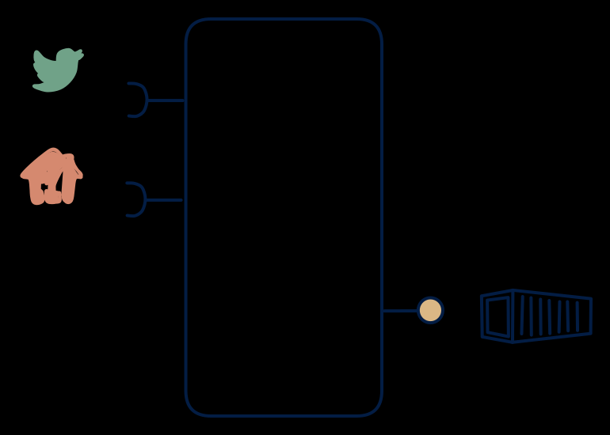

# 4.7 — Live activity → T+1 report/file

**Interface:** IN `{R, S}` → OUT `{B}`&emsp;&emsp;**Verdict:** plausible

Consumes live events + APIs, publishes a file once a day (activity report, usage file, billing input). Live activity in (events plus a reference API), a T+1 report or file out: the settlement/report bridge over a live source. The product's identity is a reporting window with a live feed behind it.

## When to use

The contract is a file but the data is inherently live.

The deliverable is a periodic file (billing input, usage report, reconciliation) but the underlying world is live — events on a feed plus a polled master/tariff API.

## What's inside

- A **stream consumer** (offsets) for the live events, plus a **poller** with a version anchor for the reference API.
- A **windowing/rollup engine** keyed to the reporting cycle (the window is the unit of truth).
- A **publication** step that assembles and places the artifact with its as-of and manifest.
- State: the open-window accumulators, the reference anchor, and the published artifacts.

## State & cost

Bounded working state (the open window) plus artifact retention, plus the reference cache from the poller. Lightweight on the live side; the file is the durable cost. Lighter than a 5.2 lake because only the window, not the full history, is held.

## Watch out

Consumers get T+1 of a T+0 world — publish with clear as-of semantics.

- The window cut is the contract: what belongs to cycle N vs N+1 (event time vs arrival time, and the grace for late events) determines the settlement truth and must be explicit.
- The reference data is polled, not live: a tariff or master change mid-window may or may not apply to that window, and the rule must be stated per report.

## Typical next step

Natural growths: a query consumer appears and a read model/API is added — **cell 4.2** or **4.6**; a reactive consumer appears and the feed is re-exposed — **4.3**/**4.4**. More reference inputs (files, more APIs) broaden IN toward **row 1**/**row 2**.

## Verdict

**plausible** — the canonical T+1-over-live bridge: a common, defensible shape wherever a live source must feed a periodic reporting or billing contract.

## Related

* [batch](/concepts/pattern-batch)
* [request/response](/concepts/pattern-request-response)
* [streaming](/concepts/pattern-streaming)
* [data-product](/concepts/data-product) — the overall model
* [verdict](/concepts/verdict) — what the common / plausible / niche tag means
