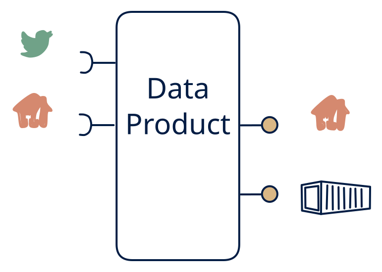

# 4.2 — Hub facade: stream + API in, API + file out

**Interface:** IN `{R, S}` → OUT `{B, R}`&emsp;&emsp;**Verdict:** common

Events + service APIs in; consumers get the query API and nightly exports (e.g., billing: events + tariff API → invoice API + D01 files). The workhorse hub of the online world: events and a reference API in; a query API and files out. One canonical state (the hub) with a live feed feeding it and two read surfaces on it.

## When to use

Consumer mix is online + batch, and sources are online.

When consumers are online queryers plus file consumers (settlement/reporting), and the source is live events plus a master/tariff API — billing, MDM, and integration hubs live here.

## What's inside

- A **stream consumer** (offsets) plus a **poller** (anchor) feeding a **canonical state store** (the hub).
- A **projection/merge** that folds the live and the reference inputs into one consistent state (the join is the heart of the product).
- A **query service** (R) and a **publication job** (B) over the same state.
- State: the canonical store, the reference anchor, offsets, and the last publication.

## State & cost

The canonical store is the cost centre: it grows with the breadth of the hub (entities times attributes) and its retention. The feed side adds offset/log retention but no new serving cost. Heavier than a 4.6 (no file tier) and lighter than a 4.1 (no feed serving).

## Watch out

- The join between the live feed and the polled reference is the core correctness risk: which version of the reference applies to which event is a decision, not a computation — get it wrong and the file and the API disagree.
- The R and B surfaces must reflect the same committed state; a publication job that reads the store mid-projection will produce files that contradict the API.

## Typical next step

Growth is adding the missing surface: a reactive consumer appears and the (derived) feed is added out — **cell 4.1** (full hub) or **4.3** (feed + files). More inputs (files, more APIs) broaden IN toward **row 1**/**row 2**. A steady-state hub often lands here and stays.

## Verdict

**common** — the canonical hub facade of the online world — the default "we need a clean queryable state and a billing file over live data" answer.

## Related

* [batch](/knowledge-concepts/pattern-batch)
* [request/response](/knowledge-concepts/pattern-request-response)
* [streaming](/knowledge-concepts/pattern-streaming)
* [data-product](/knowledge-concepts/data-product) — the overall model
* [verdict](/knowledge-concepts/verdict) — what the common / plausible / niche tag means
* [architectural paradigms](/knowledge-concepts/architectural-paradigms) — this cell maps to: Hub facade / microservices: stream + API in, API + file out.
