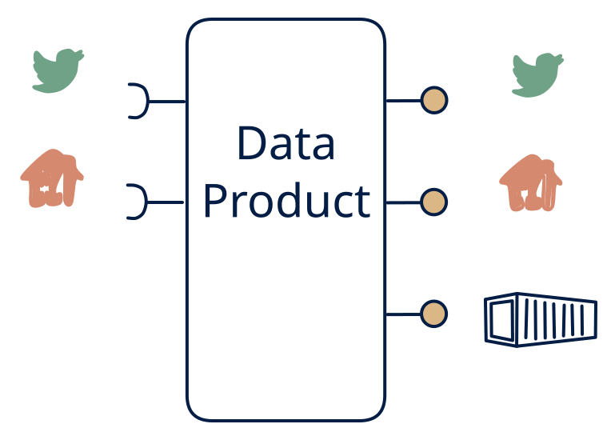

# 4.1 — MDM / integration hub with full out

**Interface:** IN `{R, S}` → OUT `{B, R, S}`&emsp;&emsp;**Verdict:** plausible

Lives entirely on APIs + events; emits files, streams, and APIs — including bulk exports built from incremental change logs.

## When to use

The product is the "system-of-record glue" (master data hub, order hub).

## Watch out

Full-load exports need a complete state store — build it.

## Related

* [batch](/knowledge-concepts/pattern-batch)
* [request/response](/knowledge-concepts/pattern-request-response)
* [streaming](/knowledge-concepts/pattern-streaming)
* [data-product](/knowledge-concepts/data-product) — the overall model
* [verdict](/knowledge-concepts/verdict) — what the common / plausible / niche tag means

