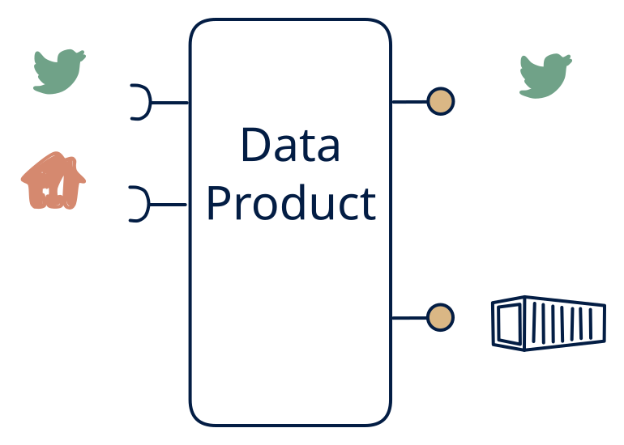

# 4.3 — Telemetry platform

**Interface:** IN `{R, S}` → OUT `{B, S}`&emsp;&emsp;**Verdict:** plausible

Events + device/service APIs in; live feeds + bulk archives out (e.g., vehicle/IoT telemetry: CAN-stream + OBD API → fleet stream + daily trip files). A telemetry platform: events plus a device/service API in; feed plus files out, no strong query surface. The live feed is the hot surface and the files the archive, with a polled reference enriching both.

## When to use

Consumers want both push and periodic full loads.

When consumers are stream subscribers and file consumers (fleet analytics, metering, device platforms) and the source is a live event feed plus a polled device/tariff API.

## What's inside

- A **stream consumer** (offsets) plus a **poller** (anchor) feeding an **enrichment/join core** (mostly stateless or lightly keyed).
- A **producer** re-exposing the enriched feed (S) and a **publication job** materialising the archive files (B).
- State: offsets, feed-log retention, artifact storage, and the reference cache — little durable keyed state unless the join is stateful.

## State & cost

Moderate: feed-log plus artifact retention dominate, with a small keyed state if the join is stateful. Cheaper than the 4.2 hub (no full canonical store) but the dual-retention (feed + archive) is a standing cost.

## Watch out

- The polled reference (device/tariff API) bounds the freshness of the enrichment: a consumer who assumes the feed's enrichment is as live as the events will be wrong by the poll cadence.
- Feed and archive describe the same events at different timestamps; reconciliation consumers need the as-of mapping, and a re-keyed feed breaks keyed archive consumers.

## Typical next step

Natural growth: a query consumer appears and a read model is added — **cell 4.2** (hub) or **4.6** (query only); a live state consumer appears — **4.4**. A file leg replacing the polled reference broadens IN toward **row 3** (the 3.7 settlement shape).

## Verdict

**plausible** — the canonical telemetry/event-spine platform — a common, defensible shape where stream subscribers and file consumers both live on a live-plus-polled source.

## Related

* [batch](/knowledge-concepts/pattern-batch)
* [request/response](/knowledge-concepts/pattern-request-response)
* [streaming](/knowledge-concepts/pattern-streaming)
* [data-product](/knowledge-concepts/data-product) — the overall model
* [verdict](/knowledge-concepts/verdict) — what the common / plausible / niche tag means
