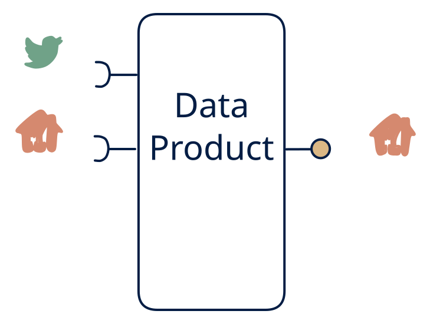

# 4.6 — Event-sourced query service (CQRS)

**Interface:** IN `{R, S}` → OUT `{R}`&emsp;&emsp;**Verdict:** common

Ingest the stream, build the read model, serve the API — the canonical event-sourcing read side (e.g., an order-status API from order events + master data APIs). A "stream → state" product.

## When to use

Consumers don't want to consume a stream; they want the answer.

## Related

* [request/response](/knowledge-concepts/pattern-request-response)
* [streaming](/knowledge-concepts/pattern-streaming)
* [data-product](/knowledge-concepts/data-product) — the overall model
* [verdict](/knowledge-concepts/verdict) — what the common / plausible / niche tag means

