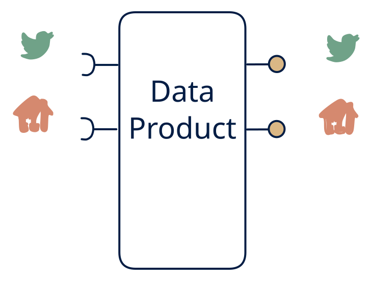

# 4.4 — Unified live view

**Interface:** IN `{R, S}` → OUT `{R, S}`&emsp;&emsp;**Verdict:** common

A clean real-time façade: one stream + one query API over the combined inputs.

## When to use

All consumers are online and a single consistent contract is wanted (unified telemetry/asset platform).

## Related

* [request/response](/knowledge-concepts/pattern-request-response)
* [streaming](/knowledge-concepts/pattern-streaming)
* [data-product](/knowledge-concepts/data-product) — the overall model
* [verdict](/knowledge-concepts/verdict) — what the common / plausible / niche tag means

