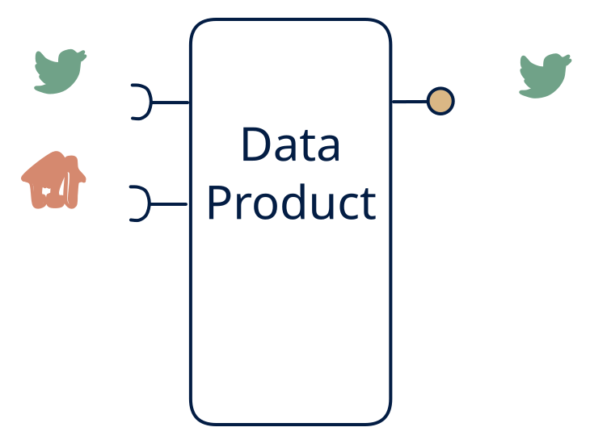

# 4.5 — API-backed fan-out stream

**Interface:** IN `{R, S}` → OUT `{S}`&emsp;&emsp;**Verdict:** niche

Changes (computed from event + API state) fanned out as one stream. An API-backed fan-out stream: events and an API in, one derived stream out. The product's whole surface is the change feed — it is a fusion engine whose output is a single ordered stream of what changed.

## When to use

Downstream is stream-first; the stream *is* the product.

When the consumer is stream-first and wants one clean change feed over two inputs (a live event feed plus a polled context) — a downstream that only ever reads a topic.

## What's inside

- A **stream consumer** (offsets) plus a **poller** (anchor) feeding a **change-detection / fusion core**.
- A **producer** emitting the single derived change feed — the sole surface.
- State: the poll anchor and a per-key working state (last-seen) for the fusion, plus the output feed log.

## State & cost

Light to moderate: a per-key last-seen working state, the poll anchor, and the output feed log. No big store, no artifacts — but the feed log's retention can grow with replay needs, and the fusion state can grow with the key space if the context is large.

## Watch out

API-polled changes become synthetic events — define exactly what "change" means (field-level? version bump?).

- The feed fuses two inputs of different freshness: events are live, the API is polled. A consumer who assumes uniform latency across the feed's fields will mis-attribute staleness to the wrong source.
- The feed is re-keyed and re-sequenced relative to both inputs; any consumer who relied on an input's partitioning or event time for this feed's semantics will break on the fusion ordering.

## Typical next step

The natural growth is the missing surfaces: a query consumer appears and a read model/API is added — **cell 4.6** or **4.4**; a file consumer (settlement, audit) appears — **4.3** or **4.2**. A file leg replacing the polled API broadens IN toward **row 3** (the 3.5 enrichment shape).

## Verdict

**niche** — a legitimate but narrow fan-out: defensible when the consumer is truly stream-first and the fusion of a live feed with a polled API is the value — less common than the query-centric row-4 cells.

## Related

* [request/response](/concepts/pattern-request-response)
* [streaming](/concepts/pattern-streaming)
* [data-product](/concepts/data-product) — the overall model
* [verdict](/concepts/verdict) — what the common / plausible / niche tag means
