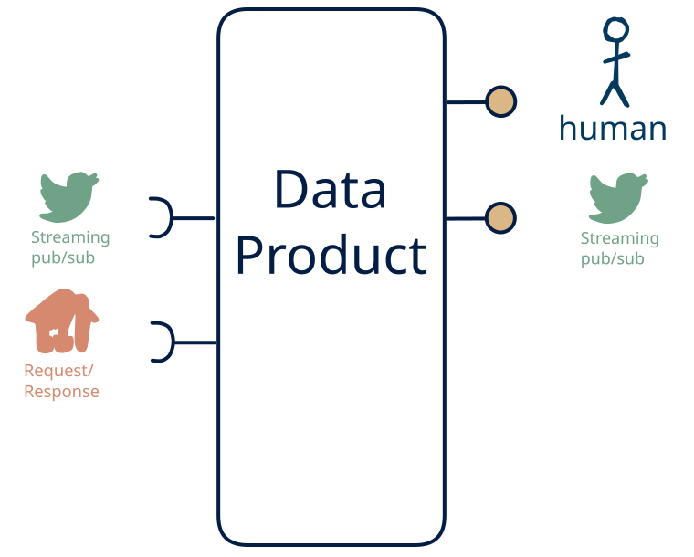

# 4.12 — live + lookup → stream + human

**Interface:** IN {R, S} → OUT {S, H}&emsp;&emsp;**Verdict:** common

A product that takes on-demand APIs and live streams and serves a live feed and a human-facing surface (dashboard/report). Machine-side inputs ({R, S}) drive it — the multi-surface serves people, not just machines.

## When to use

The data the audience wants is real, but the reader is a person, not a service: they need a report or dashboard over a single leg of upstream APIs and a live feed, not raw events or a bulk drop.

## What's inside

- Ingest: a **poller/connector** over the upstream API (version anchor, pagination, retry) and a **stream consumer** (offsets, replay) for the live leg.
- Core: a **transform** (filter/shape/route) over the live leg
- Serve: a **producer** re-exposing the (transformed) live feed and a **human-facing surface** (dashboard, report, printout, or review screen) — the layer people actually read.
- State: a durable **state store** and the **feed log** (retention).

## State & cost

Dominated by the durable state store (grows with entity/state breadth) and the input and output feed logs.

## Watch out

- A human-facing surface inherits the state behind it: the report/dashboard carries every as-of and correctness rule of the store, and a person spots a stale number faster than an API client will.
- **Mixed time bases** in the inputs (live vs. poll/cycle/human): fix the authoritative as-of per surface, or each output looks correct alone and wrong cross-checked.
- This is machine-produced, human-read: make sure a person actually reviews/approves the served view rather than the pipeline writing it straight through.

## Typical next step

add **human curation on the input side** → cell [11.12](/data-product-types/in-rsh-out-sh) when the data should not be purely machine-fed, add a **query API** → cell [4.11](/data-product-types/in-rs-out-rsh), and add a **bulk file** → cell [4.10](/data-product-types/in-rs-out-bhs); or the source world gains a leg this product does not yet take, and it migrates to a richer IN-state on the same row.

## Verdict

**common** — A product that ingests query APIs and live feeds and serves live feeds plus a human-facing surface (a dashboard, report, or review). It is the right shape where the reader is a person rather than a service, and the human-shaped view is itself what the next consumer — or the next machine in the loop — needs to act on.

## Related

* [request/response](/concepts/pattern-request-response)
* [streaming](/concepts/pattern-streaming)
* [human](/concepts/pattern-human)
* [data-product](/concepts/data-product) — the overall model
* [verdict](/concepts/verdict) — what the common / plausible / niche tag means
