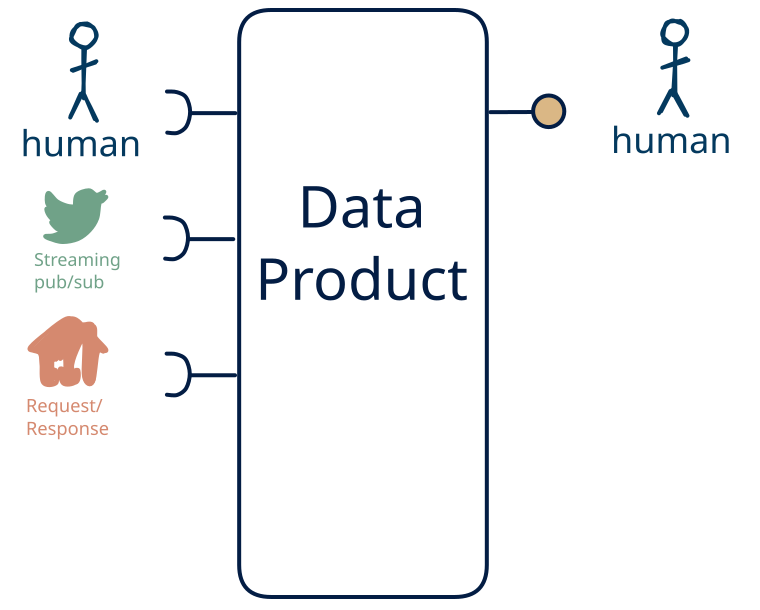

# 11.15 — API/stream + human → human-only

**Interface:** IN {R, S, H} → OUT {H}&emsp;&emsp;**Verdict:** plausible

A product that takes on-demand APIs, live streams, and human-produced data and serves a human-facing surface (dashboard/report). People both produce and read the data: the human pattern is on both sides.

## When to use

A small group of people both maintains and reads the data, with no machine consumer — a shared, human-scale record rather than an automated interface.

## What's inside

- Ingest: a **poller/connector** over the upstream API (version anchor, pagination, retry), a **stream consumer** (offsets, replay) for the live leg, and **human entry / curation** — data produced by people (forms, editors, review UIs), validated and audit-trailed on every change.
- Core: a **transform** (filter/shape/route) over the live leg and a **merge layer** that unifies human-entered data with the machine legs into one canonical view
- Serve: a **human-facing surface** (dashboard, report, printout, or review screen) — the layer people actually read.
- State: a durable **state store**, the **feed log** (retention), and an **audit trail** of human changes.

## State & cost

Dominated by the durable state store (grows with entity/state breadth) and the audit trail of human edits. Serving people is cheap to run and cheap to trust — a presentation layer over a queryable backend.

## Watch out

- Human-entered data is the softest input: it arrives irregularly, carries intent and errors, and needs **validation, provenance, and a correction path** — trust leans on the audit trail, not the schedule.
- A human-facing surface inherits the state behind it: the report/dashboard carries every as-of and correctness rule of the store, and a person spots a stale number faster than an API client will.
- **Mixed time bases** in the inputs (live vs. poll/cycle/human): fix the authoritative as-of per surface, or each output looks correct alone and wrong cross-checked.

## Typical next step

add a **query API** → cell [11.13](/data-product-types/in-rsh-out-rh), add a **bulk file** → cell [11.14](/data-product-types/in-rsh-out-bh), and add a **feed** → cell [11.12](/data-product-types/in-rsh-out-sh); or the source world gains a leg this product does not yet take, and it migrates to a richer IN-state on the same row.

## Verdict

**plausible** — people both feed and read the data, so it is a natural product, and its demand is real where this audience exists.

## Related

* [request/response](/knowledge-concepts/pattern-request-response)
* [streaming](/knowledge-concepts/pattern-streaming)
* [human](/knowledge-concepts/pattern-human)
* [data-product](/knowledge-concepts/data-product) — the overall model
* [verdict](/knowledge-concepts/verdict) — what the common / plausible / niche tag means
