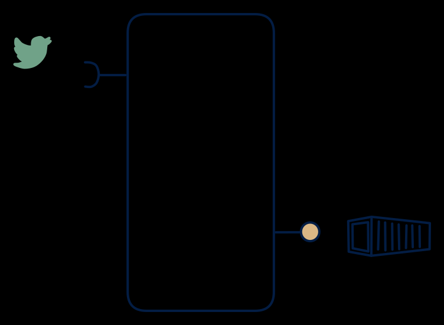

# 5.7 — Stream → settlement/rollup file

**Interface:** IN `{S}` → OUT `{B}`&emsp;&emsp;**Verdict:** plausible

Events in → periodic bulk out (meter-reading stream → daily interval file; clickstream → EOD usage files). Events in, files out: a rolling-window accumulator whose only surface is a periodic artifact. The settlement core of the streaming world — the product's identity is a window, not a store.

## When to use

The contract is a file but the data is inherently streaming — very common in utility settlement.

The contract is a file (settlement, rollup, EOD usage) but the data arrives as a stream — meter readings, clickstreams, transaction events.

## What's inside

- A **stream consumer** with per-key window state (tumbling windows keyed to the settlement/rollup cycle).
- A **window-close step** that materialises the artifact (file) and emits its manifest.
- State: window accumulators (in flight) plus the published artifacts (retained).

## State & cost

Bounded state by design: the accumulator holds at most one window of data per key, then closes. The durable cost is artifact retention, not working state. Cheap to run and easy to reason about — the risk lives in the window semantics, not the infrastructure.

## Watch out

- Late-arriving events are the core correctness problem: a grace period and a re-close (or correction) rule must be explicit, or late data silently drops out of the file.
- The as-of boundary of each window (event time vs arrival time) determines the settlement truth; consumers will audit against it.

## Typical next step

The natural growth is an online surface: a query API over the closed windows yields **cell 5.2** (lake + API) or **5.6** (a state API); a live feed re-exposed alongside the files yields **5.3**. A reference leg (batch tariff) joining IN broadens the product into **row 3** — often the actual reason these products mature.

## Verdict

**plausible** — a common, defensible shape: the cheapest way to give a streaming world the file contract settlement requires.

## Related

* [batch](/knowledge-concepts/pattern-batch)
* [streaming](/knowledge-concepts/pattern-streaming)
* [data-product](/knowledge-concepts/data-product) — the overall model
* [verdict](/knowledge-concepts/verdict) — what the common / plausible / niche tag means
