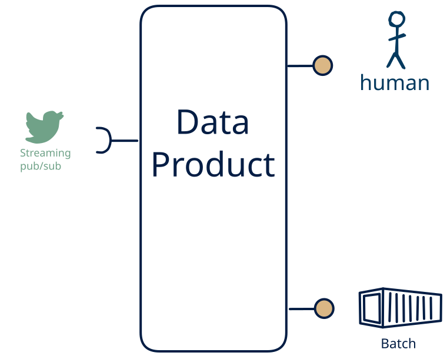

# 5.14 — stream-only → file + human

**Interface:** IN {S} → OUT {B, H}&emsp;&emsp;**Verdict:** common

A product that takes live streams and serves bulk files and a human-facing surface (dashboard/report). Machine-side inputs ({S}) drive it — the multi-surface serves people, not just machines.

## When to use

The data the audience wants is real, but the reader is a person, not a service: they need a report or dashboard over a single leg of a live feed, not raw events or a bulk drop.

## What's inside

- Ingest: a **stream consumer** (offsets, replay) for the live leg.
- Core: a **fold/aggregation core** that folds the live leg into queryable state or windowed files
- Serve: a **publication job** that materialises bulk artifacts (files/bundles) with a manifest and as-of and a **human-facing surface** (dashboard, report, printout, or review screen) — the layer people actually read.
- State: a durable **state store**, the **feed log** (retention), and the **retained bulk artifacts**.

## State & cost

Dominated by the durable state store (grows with entity/state breadth) and the retained bulk artifacts.

## Watch out

- A human-facing surface inherits the state behind it: the report/dashboard carries every as-of and correctness rule of the store, and a person spots a stale number faster than an API client will.
- Late and out-of-order events are a **first-class** question: a watermark and a re-issue/correction rule, or history gains holes and duplicate facts.
- This is machine-produced, human-read: make sure a person actually reviews/approves the served view rather than the pipeline writing it straight through.

## Typical next step

add **human curation on the input side** → cell [12.14](/data-product-types/in-sh-out-bh) when the data should not be purely machine-fed, add a **query API** → cell [5.9](/data-product-types/in-s-out-bhr), and add a **feed** → cell [5.10](/data-product-types/in-s-out-bhs); or the source world gains a leg this product does not yet take, and it migrates to a richer IN-state on the same row.

## Verdict

**common** — human-facing output (reports/dashboards) is among the most common ways people actually consume data, and its demand is real where this audience exists.

## Related

* [batch](/knowledge-concepts/pattern-batch)
* [streaming](/knowledge-concepts/pattern-streaming)
* [human](/knowledge-concepts/pattern-human)
* [data-product](/knowledge-concepts/data-product) — the overall model
* [verdict](/knowledge-concepts/verdict) — what the common / plausible / niche tag means
