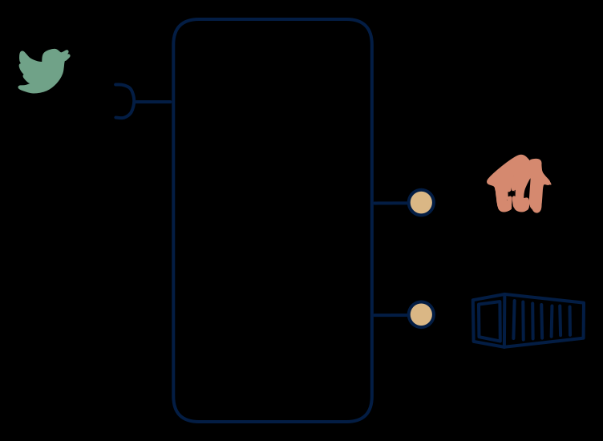

# 5.2 — Streaming ETL into lake + API

**Interface:** IN `{S}` → OUT `{B, R}`&emsp;&emsp;**Verdict:** common

Events → queryable store + data-lake files. The standard modern ingestion architecture (Kafka → S3 + API over a query engine / Iceberg). The standard modern ingestion architecture: a stream in, a queryable store plus lake files out. One source of truth (the store) with two read surfaces on it.

## When to use

Consumers want analysis (API) + archival (files); no need to keep the stream out.

Consumers want both analysis (queries against history) and bulk delivery (files), with no need to re-expose the raw stream.

## What's inside

- A **stream consumer** writing into a durable **state store** (lakehouse/warehouse) with schema enforcement.
- A **query service** (API) over the store.
- A **publication job** materialising time- or batch-sliced files.
- State: the store (grows with volume and retention) plus consumer offsets.

## State & cost

The store is the cost driver: it accumulates with every event and retention policy, and query serving competes with ingestion for throughput. Cheaper per-unit than the 5.1 full platform (no feed-serving stack), but retention is a standing, growing line item.

## Watch out

- Schema evolution at the store boundary is a contract event: a consumer pinned to an old schema will break on a migration that looks internal.
- The file export and the query surface must reflect the same committed state; a job reading the store mid-write produces files that disagree with the API.

## Typical next step

Typical growth: reactive consumers appear and the raw (or derived) feed is added back out — **cell 5.1**; a "current state" consumer appears and a read model is added — **5.6**. A reference leg joining IN broadens the product into **row 3** (the 3.2 smart-meter shape is the canonical example).

## Verdict

**common** — the canonical streaming-lake cell: one store, two read surfaces, and it is the default answer to "we have a stream and we need analysis plus files".

## Related

* [batch](/concepts/pattern-batch)
* [request/response](/concepts/pattern-request-response)
* [streaming](/concepts/pattern-streaming)
* [data-product](/concepts/data-product) — the overall model
* [verdict](/concepts/verdict) — what the common / plausible / niche tag means
* [architectural paradigms](/concepts/architectural-paradigms) — this cell maps to: Event sourcing / streaming ELT and stream processing: Kafka -> lake + queryable API.
