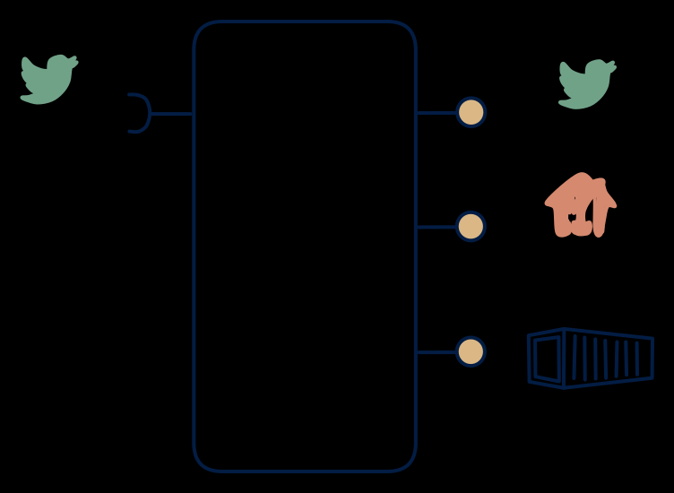

# 5.1 — Stream processor + full platform

**Interface:** IN `{S}` → OUT `{B, R, S}`&emsp;&emsp;**Verdict:** common

Stream in → stream processor / stateful aggregation → all serving modes (Flink/Kafka + state store + sink world). The full streaming platform: events in, all three serving modes out. This is the stream-processing (CEP) paradigm at full width — a stateful transform layer between the log and every kind of consumer.

## When to use

The product owns the aggregation layer between events and consumers.

When the product owns the aggregation layer: it transforms the raw feed and serves event consumers, query consumers, and bulk consumers simultaneously.

## What's inside

- A **stream-processor core** (stateful, e.g. Flink/ksqlDB) with per-key state, windows, and exactly-once (or clearly-at-least-once) guarantees.
- A **state store** for the queryable read model (the R surface).
- A **producer** re-exposing the (transformed) feed (the S surface) and a **publication job** for artifacts (the B surface).
- State: processor state + read-model store + feed log + artifacts — the widest state footprint in row 5.

## State & cost

The heaviest cell in row 5: durable processor state, a queryable store, feed-log retention, and artifact storage all at once. Justified only when all three consumer families are real; each missing family is wasted infrastructure.

## Watch out

- Watermarks and late data govern correctness of all three surfaces at once: a bad watermark poisons the read model, the re-exposed feed, and the files simultaneously.
- Backpressure couples the surfaces: a slow file-close (large artifact) can stall the live feed if they share the pipeline. Serving isolation is an architecture decision, not a nicety.

## Typical next step

At this corner, pattern growth is exhausted; the growth is horizontal — more domains, more tenants, deeper history — or an input-side maturation (reference data joining IN) that broadens the product into **row 3**/**row 4**. Dropping a surface (usually the B surface, the most expensive to keep fresh) is the common contraction.

## Verdict

**common** — the canonical "stream processor plus full platform" — the expensive, defensible answer when a stream must feed every consumer class at once.

## Related

* [batch](/concepts/pattern-batch)
* [request/response](/concepts/pattern-request-response)
* [streaming](/concepts/pattern-streaming)
* [data-product](/concepts/data-product) — the overall model
* [verdict](/concepts/verdict) — what the common / plausible / niche tag means
* [architectural paradigms](/concepts/architectural-paradigms) — this cell maps to: Stream processing (CEP, e.g. Flink/ksqlDB): a stream turned into a full serving platform.
