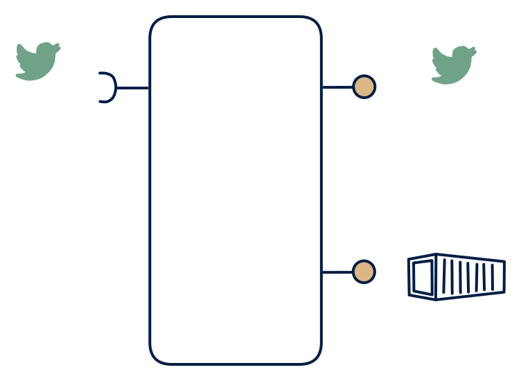

# 5.3 — Hot & cold streaming platform

**Interface:** IN `{S}` → OUT `{B, S}`&emsp;&emsp;**Verdict:** common

Events in → events out (transformed/joined) + files out (archival); a market event spine: enriched events + daily bundles. Events in, events plus files out: the event spine. The stream is the hot surface, the files the cold one, and the product's value is routing, enriching, and preserving — not transforming semantics.

## When to use

Consumers include stream consumers (downstream processors, CEP) and file consumers (analytics, settlement).

When consumers are both stream subscribers and file consumers (downstream processors, CEP, and ETL/settlement), and the value is a well-formed, enriched, durable feed.

## What's inside

- A **stream consumer** (offsets, replayable) feeding a **transform/enrich/route core** (mostly stateless or lightly keyed).
- A **producer** emitting the (enriched) feed — the S surface.
- A **sink/publication** materialising the same events into artifacts — the B surface.
- State: consumer offsets, feed-log retention, artifact storage. Little or no durable keyed state.

## State & cost

Light on state (a stateless or lightly-stateful transform) but heavy on throughput and dual-retention: the feed log and the artifact tier both accrue cost. The transform's bounded windows (if any) are the only real working state.

## Watch out

- Ordering and partitioning are the contract once the product re-keys or routes: consumers who relied on the source's partitioning will break silently if the spine changes keys.
- The B and S surfaces describe the same events at different timestamps (ingestion vs publication) — reconciliation consumers need the mapping.

## Typical next step

Natural growths: a query consumer appears and a read model is added — **cell 5.2**; a reactive state consumer appears — **5.4**. A reference leg (batch) joining IN broadens the product into **row 3** (the 3.3 hot-and-cold shape), which is how most event spines actually mature.

## Verdict

**common** — the EDA-native backbone of a streaming estate: low state, high throughput, and the default answer to "we need to enrich and preserve this feed".

## Related

* [batch](/concepts/pattern-batch)
* [streaming](/concepts/pattern-streaming)
* [data-product](/concepts/data-product) — the overall model
* [verdict](/concepts/verdict) — what the common / plausible / niche tag means
* [architectural paradigms](/concepts/architectural-paradigms) — this cell maps to: Event-driven architecture (EDA) and event sourcing: stream in, persisted as log, served as feed + archive.
