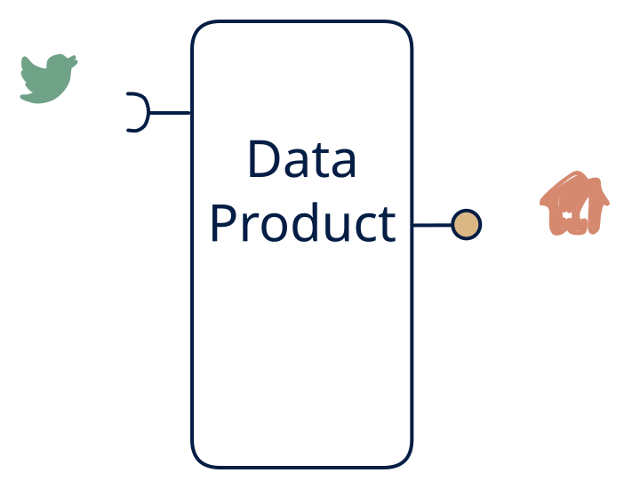

# 5.6 — Event-sourced read model

**Interface:** IN `{S}` → OUT `{R}`&emsp;&emsp;**Verdict:** common

Events in → state out via API (order status, device state, meter state APIs). A special case of the "stream → lake + API" type without the file side. The canonical event-sourcing / CQRS read side: events in, a queryable read model out. The product is the read model and the API over it — the write side is upstream, not the product.

## When to use

Consumers don't want to consume a stream; they want the answer.

Consumers want the answer, not the feed: order status, device state, meter state, any "current value of X" query over an event-sourced world.

## What's inside

- A **stream consumer** (offsets, replayable) projecting events into the **read-model store**.
- A **projection/fold** with per-key version or sequence handling (so out-of-order and retries don't corrupt state).
- A **query service** (the sole surface, plus its auth/pagination/versioning).
- State: the read-model store (grows with the number of entities, not the event count) plus consumer offsets.

## State & cost

The read-model store is bounded by entity count, not event volume — a fold, not a log — so the state cost is predictable even as traffic scales. Offsets are the only replay liability. No feed, no artifacts: the lightest durable cell in row 5 alongside 5.5.

## Watch out

- Projection bugs are data corruption, not a bad request: a wrong fold silently rewrites the read model, and the fix is a replay — keep the log replayable and the projection testable in isolation.
- "Current state" has a lag: consumers who assume the read model is as fresh as the feed will be wrong by the projection's processing time. The as-of bound belongs in the API.

## Typical next step

Growth is adding surfaces: a feed consumer appears and the (derived) stream is re-exposed — **cell 5.4**; bulk/settlement appears — **5.2** or **5.7**. A reference leg joining IN broadens the product into **row 3** (the 3.6 historian shape is the classic destination for metering).

## Verdict

**common** — the canonical "stream to state" product — the default read-side answer in an event-driven estate, and cheap relative to the state it removes for consumers.

## Related

* [request/response](/concepts/pattern-request-response)
* [streaming](/concepts/pattern-streaming)
* [data-product](/concepts/data-product) — the overall model
* [verdict](/concepts/verdict) — what the common / plausible / niche tag means
* [architectural paradigms](/concepts/architectural-paradigms) — this cell maps to: Event sourcing and CQRS read model (also stream processing): fold the event log into a queryable state store.
