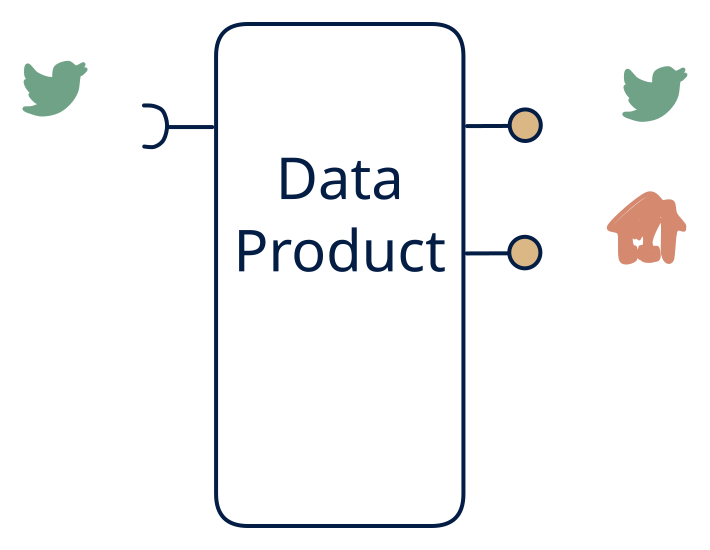

# 5.4 — Event + state, no files

**Interface:** IN `{S}` → OUT `{R, S}`&emsp;&emsp;**Verdict:** niche

Stream in → event feed + state API; no bulk out (archival handled off-product). A live platform over a stream: a queryable state and a re-exposed feed, but no files. The "no files" cut is the defining trait — archival is handled elsewhere (or not at all).

## When to use

All consumers are online and archival is a separate product's job.

All consumers are online (they query and/or subscribe) and long-term bulk is a separate warehouse's job — a real-time operational platform.

## What's inside

- A **stream consumer** feeding both a **read-model store** and a **producer** (the re-exposed feed).
- A **projection/fold** with per-key versioning (shared by the state and the feed, so they agree).
- A **query service** (R) and the feed (S) as the two surfaces.
- State: read-model store + feed log + offsets — no artifacts.

## State & cost

Moderate state: the read model plus feed-log retention, with no artifact tier. The feed log's retention policy is the quiet growth line — replay needs can make it large even though the serving state is small.

## Watch out

Same retention concern as the file-less serving cells — verify where history lives.

- The state and the feed must agree on "now": derive both from the same projection commit, or they will drift and consumers will notice via reconciliation.
- With no B surface, there is no artifact as the durability anchor — the feed log and the store are the only recovery paths, and their retention policies must be explicit.

## Typical next step

The natural addition is the file surface: bulk/settlement or reconciliation consumers appear and files are added — **cell 5.3** (feed + files) or **5.2** (files + API). A reference leg joining IN broadens the product into **row 3** (the 3.4 shape).

## Verdict

**niche** — plausible as a deliberately-fileless live platform; the "no files" cut is a scope decision that must be owned elsewhere, which is what keeps it out of the common tier.

## Related

* [request/response](/knowledge-concepts/pattern-request-response)
* [streaming](/knowledge-concepts/pattern-streaming)
* [data-product](/knowledge-concepts/data-product) — the overall model
* [verdict](/knowledge-concepts/verdict) — what the common / plausible / niche tag means
