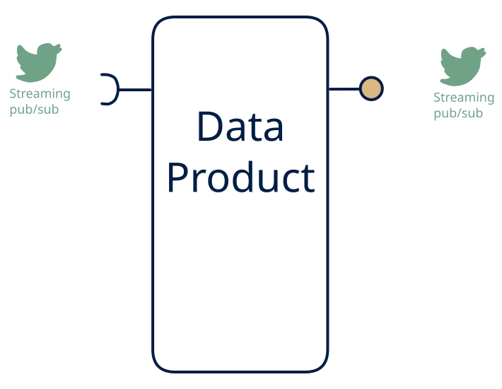

# 5.5 — Event transformer / relay

**Interface:** IN `{S}` → OUT `{S}`&emsp;&emsp;**Verdict:** common

A pure stream-to-stream product: filter, route, enrich, project (topic in → topics out). The value is the transformation, not the serving. The purest stateless cell in the space: a stream in, a stream out. Filter, route, enrich, project — the value is the transformation itself, and the product is cheap because it holds nothing.

## When to use

Consumers need a *derived* topic and the product can be stateless by nature.

When the need is a derived feed: a cleaned, schema-mapped, enriched, or routed stream for downstream consumers — and there is no state, no files, no queries to serve.

## What's inside

- A **stream consumer** (offsets) feeding a **stateless transform** (filter, map, project, enrich from a lookaside static table, route).
- A **producer** emitting the transformed topic(s) — the single surface.
- State: consumer offsets only (plus a bounded in-flight buffer). No store, no log of its own beyond the platform's.

## State & cost

The floor of the space: no durable state of its own, retention inherited from the streaming platform, and scale is purely throughput. Operational cost is minimal — which is why this is the default first product in a Kafka estate, and why its failure modes are all about the contract, not the cost.

## Watch out

No state persistence beyond the topic — the product is ephemeral by design.

- The "stateless" promise is the contract: the moment a join needs a second stream or a lookup table with freshness, the product is no longer this cell and its failure modes change (late data, skew, state growth).
- Ordering and partitioning must be preserved or deliberately relaxed, and the relaxation must be documented — a repartition is a silent break for any keyed consumer downstream.

## Typical next step

Growth is the moment state is needed: a join or a "current state" consumer appears and the product gains a store — it becomes **cell 5.6** (state) or **5.3** (enrichment with files). A stateful aggregation over a window moves it toward **5.1**. Adding a B or R surface is the step out of the stateless tier.

## Verdict

**common** — the default first streaming product: cheap, stateless, and ubiquitous in Kafka/CEP estates — the baseline against which every other cell's cost is measured.

## Related

* [streaming](/concepts/pattern-streaming)
* [data-product](/concepts/data-product) — the overall model
* [verdict](/concepts/verdict) — what the common / plausible / niche tag means
* [architectural paradigms](/concepts/architectural-paradigms) — this cell maps to: Serverless / Functions-as-a-Service and event-driven (EDA): a stateless stream-to-stream transform.
