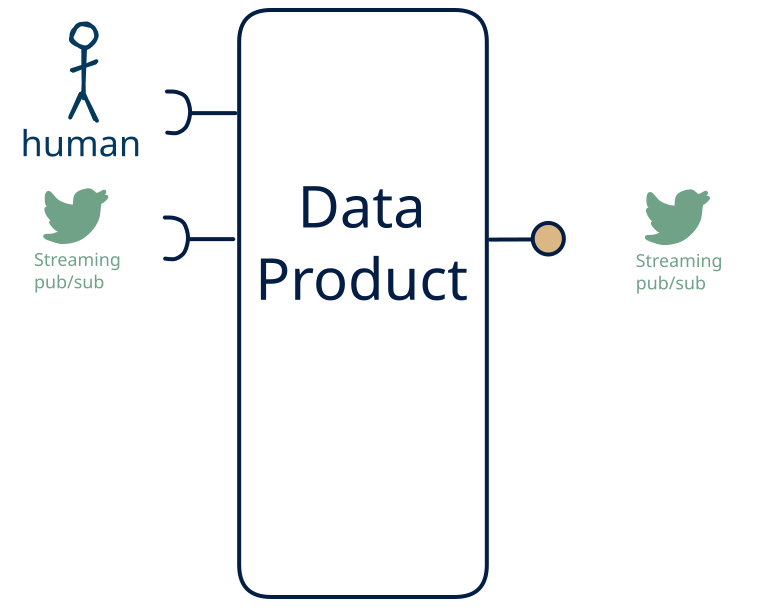

# 12.5 — stream + human → stream-only

**Interface:** IN {S, H} → OUT {S}&emsp;&emsp;**Verdict:** plausible

A product that takes live streams and human-produced data and serves a live feed. Human-entered data is one leg of the source, alongside live streams; the product carries that mix through to a live feed.

## When to use

The data is partly human-curated, alongside live streams, and the audience needs it as a live feed — the product is the layer between a person's editing and the consumer.

## What's inside

- Ingest: a **stream consumer** (offsets, replay) for the live leg and **human entry / curation** — data produced by people (forms, editors, review UIs), validated and audit-trailed on every change.
- Core: a **transform** (filter/shape/route) over the live leg
- Serve: a **producer** re-exposing the (transformed) live feed.
- State: a durable **state store**, the **feed log** (retention), and an **audit trail** of human changes.

## State & cost

Dominated by the durable state store (grows with entity/state breadth), the input and output feed logs, and the audit trail of human edits.

## Watch out

- Human-entered data is the softest input: it arrives irregularly, carries intent and errors, and needs **validation, provenance, and a correction path** — trust leans on the audit trail, not the schedule.

## Typical next step

add a **human-facing surface** → cell [12.12](/data-product-types/in-sh-out-sh), add a **query API** → cell [12.4](/data-product-types/in-sh-out-rs), and add a **bulk file** → cell [12.3](/data-product-types/in-sh-out-bs); or the source world gains a leg this product does not yet take, and it migrates to a richer IN-state on the same row.

## Verdict

**plausible** — turning human-entered data into a downstream surface is sensible but project-shaped — a curation product, not a default pipe, and its demand is real where this audience exists.

## Related

* [streaming](/knowledge-concepts/pattern-streaming)
* [human](/knowledge-concepts/pattern-human)
* [data-product](/knowledge-concepts/data-product) — the overall model
* [verdict](/knowledge-concepts/verdict) — what the common / plausible / niche tag means
