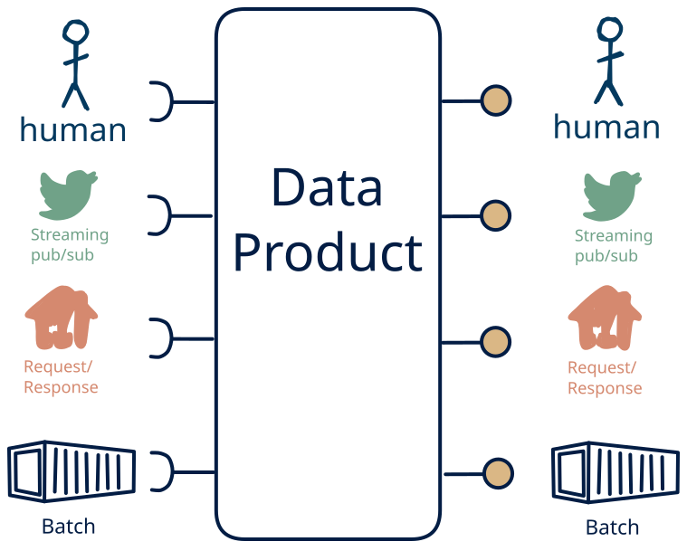

# Data Product Interface Patterns

A **data product** is a self-contained offering of data to external
consumers: the **data** itself, a **contract** (schema, semantics, update
cycle, as-of and availability guarantees, access conditions), and one or
more **interfaces** through which consumers actually obtain the data. The
term is used in the sense of **data mesh**: a data product is the
fundamental, domain-owned unit of data architecture, and consumers depend
on its offering and its contract — not on a raw extract from someone else's
store.

The product's *identity* is what it offers, not how it is exposed. A single
product may carry one or several interfaces: the same records served as a
file drop, as a query API, and as an event stream are **one data product**
available through its interfaces, not three different products.

This catalog therefore classifies the **types** of data products by their
interfaces, not by the data they carry. Each side of a product — the
**input side** (how it ingests) and the **output side** (how it serves) —
is described by the integration patterns it uses, and a **type** is the
pair (IN-state × OUT-state): a space of **225 data product types**, each
with its own concept doc — what it is, when to use it, and a
[verdict](/knowledge-concepts/verdict) (common / plausible / niche).

## The interface model

The four **integration patterns** are modes of data movement, independent
of any concrete protocol:

- **B — Batch:** bulk/file delivery on a schedule (polling upstream, or delivering files downstream)
- **R — Request/response:** synchronous on-demand query (serving APIs, or polling upstream)
- **S — Streaming:** continuous pub/sub push (consuming events, or serving a feed)
- **H — Human:** data produced by people (input side), or a human-facing surface such as reports, dashboards, or review (output side)

Each side may carry any non-empty subset of the four patterns. There are
**15 side states** per side — the working names and pattern contents:

| Code | Working name | Patterns |
|---|---|---|
| `BRS`  | omni-channel | batch + request/response + streaming |
| `BR`   | query + file | request/response + batch |
| `BS`   | hot & cold | streaming + batch |
| `RS`   | live + lookup | streaming + request/response |
| `S`    | stream-only | streaming |
| `R`    | request-response only | request/response |
| `B`    | batch-only | batch |
| `BRSH` | omni-channel + human | batch + request/response + streaming + human |
| `BHR`  | file/API + human | batch + request/response + human |
| `BHS`  | file/stream + human | batch + streaming + human |
| `RSH`  | API/stream + human | request/response + streaming + human |
| `SH`   | stream + human | streaming + human |
| `RH`   | API + human | request/response + human |
| `BH`   | file + human | batch + human |
| `H`    | human-only | human |

## The 225-type matrix

Rows = IN-states (how the product ingests), columns = OUT-states (how it serves). The left 7×7 block is the machine-only space (B/R/S); rows and columns 8–15 add the human pattern. Every cell is a data product type with its own page — what it is, when to use it, and its verdict.

| IN \ OUT | BRS | BR | BS | RS | S | R | B | BRSH | BHR | BHS | RSH | SH | RH | BH | H |
|---|---|---|---|---|---|---|---|---|---|---|---|---|---|---|---|
| **BRS** | [1.1](/data-product-types/in-brs-out-brs) | [1.2](/data-product-types/in-brs-out-br) | [1.3](/data-product-types/in-brs-out-bs) | [1.4](/data-product-types/in-brs-out-rs) | [1.5](/data-product-types/in-brs-out-s) | [1.6](/data-product-types/in-brs-out-r) | [1.7](/data-product-types/in-brs-out-b) | [1.8](/data-product-types/in-brs-out-brsh) | [1.9](/data-product-types/in-brs-out-bhr) | [1.10](/data-product-types/in-brs-out-bhs) | [1.11](/data-product-types/in-brs-out-rsh) | [1.12](/data-product-types/in-brs-out-sh) | [1.13](/data-product-types/in-brs-out-rh) | [1.14](/data-product-types/in-brs-out-bh) | [1.15](/data-product-types/in-brs-out-h) |
| **BR**  | [2.1](/data-product-types/in-br-out-brs) | [2.2](/data-product-types/in-br-out-br) | [2.3](/data-product-types/in-br-out-bs) | [2.4](/data-product-types/in-br-out-rs) | [2.5](/data-product-types/in-br-out-s) | [2.6](/data-product-types/in-br-out-r) | [2.7](/data-product-types/in-br-out-b) | [2.8](/data-product-types/in-br-out-brsh) | [2.9](/data-product-types/in-br-out-bhr) | [2.10](/data-product-types/in-br-out-bhs) | [2.11](/data-product-types/in-br-out-rsh) | [2.12](/data-product-types/in-br-out-sh) | [2.13](/data-product-types/in-br-out-rh) | [2.14](/data-product-types/in-br-out-bh) | [2.15](/data-product-types/in-br-out-h) |
| **BS**  | [3.1](/data-product-types/in-bs-out-brs) | [3.2](/data-product-types/in-bs-out-br) | [3.3](/data-product-types/in-bs-out-bs) | [3.4](/data-product-types/in-bs-out-rs) | [3.5](/data-product-types/in-bs-out-s) | [3.6](/data-product-types/in-bs-out-r) | [3.7](/data-product-types/in-bs-out-b) | [3.8](/data-product-types/in-bs-out-brsh) | [3.9](/data-product-types/in-bs-out-bhr) | [3.10](/data-product-types/in-bs-out-bhs) | [3.11](/data-product-types/in-bs-out-rsh) | [3.12](/data-product-types/in-bs-out-sh) | [3.13](/data-product-types/in-bs-out-rh) | [3.14](/data-product-types/in-bs-out-bh) | [3.15](/data-product-types/in-bs-out-h) |
| **RS**  | [4.1](/data-product-types/in-rs-out-brs) | [4.2](/data-product-types/in-rs-out-br) | [4.3](/data-product-types/in-rs-out-bs) | [4.4](/data-product-types/in-rs-out-rs) | [4.5](/data-product-types/in-rs-out-s) | [4.6](/data-product-types/in-rs-out-r) | [4.7](/data-product-types/in-rs-out-b) | [4.8](/data-product-types/in-rs-out-brsh) | [4.9](/data-product-types/in-rs-out-bhr) | [4.10](/data-product-types/in-rs-out-bhs) | [4.11](/data-product-types/in-rs-out-rsh) | [4.12](/data-product-types/in-rs-out-sh) | [4.13](/data-product-types/in-rs-out-rh) | [4.14](/data-product-types/in-rs-out-bh) | [4.15](/data-product-types/in-rs-out-h) |
| **S**   | [5.1](/data-product-types/in-s-out-brs) | [5.2](/data-product-types/in-s-out-br) | [5.3](/data-product-types/in-s-out-bs) | [5.4](/data-product-types/in-s-out-rs) | [5.5](/data-product-types/in-s-out-s) | [5.6](/data-product-types/in-s-out-r) | [5.7](/data-product-types/in-s-out-b) | [5.8](/data-product-types/in-s-out-brsh) | [5.9](/data-product-types/in-s-out-bhr) | [5.10](/data-product-types/in-s-out-bhs) | [5.11](/data-product-types/in-s-out-rsh) | [5.12](/data-product-types/in-s-out-sh) | [5.13](/data-product-types/in-s-out-rh) | [5.14](/data-product-types/in-s-out-bh) | [5.15](/data-product-types/in-s-out-h) |
| **R**   | [6.1](/data-product-types/in-r-out-brs) | [6.2](/data-product-types/in-r-out-br) | [6.3](/data-product-types/in-r-out-bs) | [6.4](/data-product-types/in-r-out-rs) | [6.5](/data-product-types/in-r-out-s) | [6.6](/data-product-types/in-r-out-r) | [6.7](/data-product-types/in-r-out-b) | [6.8](/data-product-types/in-r-out-brsh) | [6.9](/data-product-types/in-r-out-bhr) | [6.10](/data-product-types/in-r-out-bhs) | [6.11](/data-product-types/in-r-out-rsh) | [6.12](/data-product-types/in-r-out-sh) | [6.13](/data-product-types/in-r-out-rh) | [6.14](/data-product-types/in-r-out-bh) | [6.15](/data-product-types/in-r-out-h) |
| **B**   | [7.1](/data-product-types/in-b-out-brs) | [7.2](/data-product-types/in-b-out-br) | [7.3](/data-product-types/in-b-out-bs) | [7.4](/data-product-types/in-b-out-rs) | [7.5](/data-product-types/in-b-out-s) | [7.6](/data-product-types/in-b-out-r) | [7.7](/data-product-types/in-b-out-b) | [7.8](/data-product-types/in-b-out-brsh) | [7.9](/data-product-types/in-b-out-bhr) | [7.10](/data-product-types/in-b-out-bhs) | [7.11](/data-product-types/in-b-out-rsh) | [7.12](/data-product-types/in-b-out-sh) | [7.13](/data-product-types/in-b-out-rh) | [7.14](/data-product-types/in-b-out-bh) | [7.15](/data-product-types/in-b-out-h) |
| **BRSH** | [8.1](/data-product-types/in-brsh-out-brs) | [8.2](/data-product-types/in-brsh-out-br) | [8.3](/data-product-types/in-brsh-out-bs) | [8.4](/data-product-types/in-brsh-out-rs) | [8.5](/data-product-types/in-brsh-out-s) | [8.6](/data-product-types/in-brsh-out-r) | [8.7](/data-product-types/in-brsh-out-b) | [8.8](/data-product-types/in-brsh-out-brsh) | [8.9](/data-product-types/in-brsh-out-bhr) | [8.10](/data-product-types/in-brsh-out-bhs) | [8.11](/data-product-types/in-brsh-out-rsh) | [8.12](/data-product-types/in-brsh-out-sh) | [8.13](/data-product-types/in-brsh-out-rh) | [8.14](/data-product-types/in-brsh-out-bh) | [8.15](/data-product-types/in-brsh-out-h) |
| **BHR** | [9.1](/data-product-types/in-bhr-out-brs) | [9.2](/data-product-types/in-bhr-out-br) | [9.3](/data-product-types/in-bhr-out-bs) | [9.4](/data-product-types/in-bhr-out-rs) | [9.5](/data-product-types/in-bhr-out-s) | [9.6](/data-product-types/in-bhr-out-r) | [9.7](/data-product-types/in-bhr-out-b) | [9.8](/data-product-types/in-bhr-out-brsh) | [9.9](/data-product-types/in-bhr-out-bhr) | [9.10](/data-product-types/in-bhr-out-bhs) | [9.11](/data-product-types/in-bhr-out-rsh) | [9.12](/data-product-types/in-bhr-out-sh) | [9.13](/data-product-types/in-bhr-out-rh) | [9.14](/data-product-types/in-bhr-out-bh) | [9.15](/data-product-types/in-bhr-out-h) |
| **BHS** | [10.1](/data-product-types/in-bhs-out-brs) | [10.2](/data-product-types/in-bhs-out-br) | [10.3](/data-product-types/in-bhs-out-bs) | [10.4](/data-product-types/in-bhs-out-rs) | [10.5](/data-product-types/in-bhs-out-s) | [10.6](/data-product-types/in-bhs-out-r) | [10.7](/data-product-types/in-bhs-out-b) | [10.8](/data-product-types/in-bhs-out-brsh) | [10.9](/data-product-types/in-bhs-out-bhr) | [10.10](/data-product-types/in-bhs-out-bhs) | [10.11](/data-product-types/in-bhs-out-rsh) | [10.12](/data-product-types/in-bhs-out-sh) | [10.13](/data-product-types/in-bhs-out-rh) | [10.14](/data-product-types/in-bhs-out-bh) | [10.15](/data-product-types/in-bhs-out-h) |
| **RSH** | [11.1](/data-product-types/in-rsh-out-brs) | [11.2](/data-product-types/in-rsh-out-br) | [11.3](/data-product-types/in-rsh-out-bs) | [11.4](/data-product-types/in-rsh-out-rs) | [11.5](/data-product-types/in-rsh-out-s) | [11.6](/data-product-types/in-rsh-out-r) | [11.7](/data-product-types/in-rsh-out-b) | [11.8](/data-product-types/in-rsh-out-brsh) | [11.9](/data-product-types/in-rsh-out-bhr) | [11.10](/data-product-types/in-rsh-out-bhs) | [11.11](/data-product-types/in-rsh-out-rsh) | [11.12](/data-product-types/in-rsh-out-sh) | [11.13](/data-product-types/in-rsh-out-rh) | [11.14](/data-product-types/in-rsh-out-bh) | [11.15](/data-product-types/in-rsh-out-h) |
| **SH**  | [12.1](/data-product-types/in-sh-out-brs) | [12.2](/data-product-types/in-sh-out-br) | [12.3](/data-product-types/in-sh-out-bs) | [12.4](/data-product-types/in-sh-out-rs) | [12.5](/data-product-types/in-sh-out-s) | [12.6](/data-product-types/in-sh-out-r) | [12.7](/data-product-types/in-sh-out-b) | [12.8](/data-product-types/in-sh-out-brsh) | [12.9](/data-product-types/in-sh-out-bhr) | [12.10](/data-product-types/in-sh-out-bhs) | [12.11](/data-product-types/in-sh-out-rsh) | [12.12](/data-product-types/in-sh-out-sh) | [12.13](/data-product-types/in-sh-out-rh) | [12.14](/data-product-types/in-sh-out-bh) | [12.15](/data-product-types/in-sh-out-h) |
| **RH**  | [13.1](/data-product-types/in-rh-out-brs) | [13.2](/data-product-types/in-rh-out-br) | [13.3](/data-product-types/in-rh-out-bs) | [13.4](/data-product-types/in-rh-out-rs) | [13.5](/data-product-types/in-rh-out-s) | [13.6](/data-product-types/in-rh-out-r) | [13.7](/data-product-types/in-rh-out-b) | [13.8](/data-product-types/in-rh-out-brsh) | [13.9](/data-product-types/in-rh-out-bhr) | [13.10](/data-product-types/in-rh-out-bhs) | [13.11](/data-product-types/in-rh-out-rsh) | [13.12](/data-product-types/in-rh-out-sh) | [13.13](/data-product-types/in-rh-out-rh) | [13.14](/data-product-types/in-rh-out-bh) | [13.15](/data-product-types/in-rh-out-h) |
| **BH**  | [14.1](/data-product-types/in-bh-out-brs) | [14.2](/data-product-types/in-bh-out-br) | [14.3](/data-product-types/in-bh-out-bs) | [14.4](/data-product-types/in-bh-out-rs) | [14.5](/data-product-types/in-bh-out-s) | [14.6](/data-product-types/in-bh-out-r) | [14.7](/data-product-types/in-bh-out-b) | [14.8](/data-product-types/in-bh-out-brsh) | [14.9](/data-product-types/in-bh-out-bhr) | [14.10](/data-product-types/in-bh-out-bhs) | [14.11](/data-product-types/in-bh-out-rsh) | [14.12](/data-product-types/in-bh-out-sh) | [14.13](/data-product-types/in-bh-out-rh) | [14.14](/data-product-types/in-bh-out-bh) | [14.15](/data-product-types/in-bh-out-h) |
| **H**   | [15.1](/data-product-types/in-h-out-brs) | [15.2](/data-product-types/in-h-out-br) | [15.3](/data-product-types/in-h-out-bs) | [15.4](/data-product-types/in-h-out-rs) | [15.5](/data-product-types/in-h-out-s) | [15.6](/data-product-types/in-h-out-r) | [15.7](/data-product-types/in-h-out-b) | [15.8](/data-product-types/in-h-out-brsh) | [15.9](/data-product-types/in-h-out-bhr) | [15.10](/data-product-types/in-h-out-bhs) | [15.11](/data-product-types/in-h-out-rsh) | [15.12](/data-product-types/in-h-out-sh) | [15.13](/data-product-types/in-h-out-rh) | [15.14](/data-product-types/in-h-out-bh) | [15.15](/data-product-types/in-h-out-h) |

The model in full — side states, cell numbering, and the reasoning behind
the types — is described in [Data product](/knowledge-concepts/data-product).
To place a real data product into one of the cells, follow the
[classify-a-data-product](/playbooks/classify-a-data-product) playbook.

## Sections

* [Knowledge Concepts](/knowledge-concepts/) - Core vocabulary: the data product, the four integration patterns, the interface model, the verdict tag, and structural observations about the 225-type space
* [Data Product Types](/data-product-types/) - All 225 data product types (IN × OUT), each described: what it is, when to use it, verdict
* [Playbooks](/playbooks/) - Procedures for using the catalog, starting with how to classify a real data product
